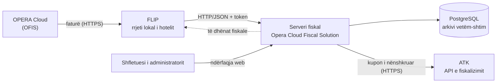

# Përshkrimi i përgjithshëm i zgjidhjes softuerike — Opera Cloud Fiscal Solution - Kosovo

Behar Lushaku · 12.10.2026

## 1. Përmbledhje

**Opera Cloud Fiscal Solution - Kosovo** (versioni 1.0.0) është Softuer Elektronik Fiskal për hotele që përdorin sistemin e menaxhimit **Oracle OPERA Cloud**. Kur recepsionisti mbyll (paguan) faturën e mysafirit në OPERA, softueri e shndërron atë në kupon fiskal, e nënshkruan me certifikatën e ATK-së për atë pikë shitjeje, e raporton menjëherë në ATK dhe ia kthen OPERA-së të dhënat fiskale (numri i kuponit, NUIKF, ID e SEF-it, kodi QR) për t'u shtypur në faturë.

|  |  |
| --- | --- |
| Përdoruesit | Hotelet në Kosovë (tatimpagues që bëjnë shitje me pakicë ndaj konsumatorit final) |
| Pika e shitjes (POS) | Çdo vendpunës që lëshon fatura në OPERA është POS i veçantë i regjistruar në ATK, me certifikatën e vet |
| Llojet e kuponit | Shitje; Kthim dhe Anulim (me referencë në kuponin origjinal); kupon i shënuar nga blloku i veçantë |
| Instalimi | Server Windows në rrjetin lokal të hotelit; ndërfaqe administrimi në shfletues |
| Ruajtja | Arkiv i pandryshueshëm i të gjithë kuponeve, transmetimeve, mesazheve nga OPERA dhe regjistrit të auditimit |
| Testimi | Testuar në mjedisin TEST të ATK-së më 08.10.2026 (11 skenarë, përfshirë refuzimin e nënshkrimit të manipuluar dhe të kthimit pa referencë) |

**Zhvilluesi dhe mirëmbajtësi:** Behar Lushaku (person fizik).

## 2. Arkitektura

Serveri fiskal në rrjetin lokal të hotelit është e vetmja pjesë që komunikon me ATK-në; OPERA merr prej tij të dhënat fiskale për t'i shtypur në faturë. Çdo vendpunës që lëshon fatura në OPERA është POS i veçantë në ATK, me certifikatën dhe çelësin e vet në server.

**Çfarë janë OFIS dhe FLIP.** Janë dy komponentë të Oracle-it, prodhuesit të OPERA Cloud, përmes të cilëve OPERA dërgon faturat te softueri fiskal:

| Komponenti | Çfarë është | Roli në këtë zgjidhje |
| --- | --- | --- |
| **OFIS** — OPERA Fiscal Integration Solution | Funksioni i OPERA Cloud për fiskalizim. Në çdo ngjarje fiskale (mbyllja e faturës, check-out, pagesa) OPERA krijon një mesazh standard me të gjitha të dhënat e faturës (artikujt, TVSH-ja, pagesat, totalet, hoteli, terminali) dhe e dërgon te partneri fiskal i konfiguruar | Burimi i të dhënave: konfigurohet në OPERA Cloud (Administration › Financials › Fiscal Management) me partnerin, terminalet fiskale dhe parametrat |
| **FLIP** — Fiscal Layer Integration Platform | Program i Oracle-it që instalohet në rrjetin lokal të hotelit. Merr mesazhin e OFIS nga OPERA Cloud, e përcjell te softueri fiskal lokal dhe ia kthen OPERA-së përgjigjen | Ura mes OPERA Cloud dhe serverit fiskal: thirr serverin fiskal në adresën e tij në rrjetin lokal, me token qasjeje |

OFIS dhe FLIP nuk fiskalizojnë vetë: ato vetëm dërgojnë faturën. Fiskalizimin sipas kërkesave të ATK-së (numerimi, nënshkrimi, raportimi, ruajtja) e bën Opera Cloud Fiscal Solution - Kosovo.

## 3. Funksionalitetet

**Nga fatura në kupon fiskal.** Kur fatura mbyllet në OPERA, softueri:

1. merr mesazhin e faturës nga OPERA (përmes FLIP) dhe e ruan ashtu siç është pranuar;
2. verifikon që fatura i përket këtij biznesi dhe që shumat janë të sakta (kapitulli 5);
3. ndërton kuponin fiskal: artikujt, grupet e TVSH-së, pagesat, totalet;
4. rillogarit kuponin në mënyrë të pavarur dhe e nënshkruan me çelësin e POS-it;
5. e ruan kuponin në arkiv **para** dërgimit, pastaj e dërgon në ATK dhe ruan përgjigjen (ID e transaksionit);
6. ia kthen OPERA-së të dhënat fiskale për shtypje në faturë.

Një faturë e dërguar përsëri (rishtypje ose dërgim i përsëritur nga OPERA) nuk krijon kupon të ri: softueri kthen kuponin e parë.

**Shtypja e kuponit.** Hoteli zgjedh në cilësime ku shtypet kuponi për mysafirin: në bllokun fiskal të faturës së OPERA-s, ose në printerin termik (58 ose 80 mm) të vendpunësit. Në rastin e dytë serveri fiskal e shtyp vetë kuponin e plotë sipas shembujve të ATK-së, menjëherë pas fiskalizimit, në printer të lidhur në rrjet, me USB ose me portë seriale (COM) në serverin fiskal (p.sh. Epson TM-T88VII). Shtypja e parë është origjinali; shtypjet e mëvonshme shënohen "KOPJE E KUPONIT". Çdo shtypje dhe çdo dështim regjistrohen në auditim; një printer që nuk punon nuk e ndal fiskalizimin.

**Llojet e kuponit.**

| Lloji | Kur | Veçoritë |
| --- | --- | --- |
| Shitje | Fatura mbyllet me pagesë | Kupon i ri me numerim të vazhdueshëm dhe numër ditor për vendpunës |
| Kthim | Fatura ka shumë negative (korrigjim) | I referohet kuponit origjinal (ReferenceNo); pa referencë refuzohet |
| Anulim | Gabim i vërejtur pas lëshimit të kuponit | "KUPON FISKAL I ANULUAR" me të njëjtat rreshta dhe shuma, me arsyen e anulimit, i lidhur me origjinalin; një herë për kupon |
| Kupon nga blloku | Pajisja ose serveri ka ndaluar plotësisht | Kuponi i shkruar me dorë shënohet pastaj në softuer me numrin serik dhe kohën e letrës, nënshkruhet dhe dërgohet në ATK |
| Kopje | Rishtypje e kuponit ekzistues | E shënuar "KOPJE E KUPONIT"; nuk dërgohet në ATK; regjistrohet në auditim |

**Numerimi.** Numri i kuponit (CouponId) është unik për të gjithë biznesin; NUIKF (numri i verifikimit, deri në 16 karaktere) gjenerohet nga softueri për çdo kupon; ID e SEF-it ka formën `[Njësia]-[NUI]-[POS]`.

**Përmbajtja e kuponit.** NUI dhe numri i TVSH-së, njësia dhe adresa, operatori, artikujt (çmimi njësi me 4 decimale, sasia, totali), TVSH sipas shkronjave të ATK-së (A, C, D, E), pagesat sipas llojit (kesh, kartelë, vauçer, çek, tjetër), totali, TVSH-ja, baza pa TVSH, numri i kuponit, numri ditor ("KUPON FISKAL DITOR NR."), NUIKF, ID e SEF-it, data dhe ora, kodi QR, teksti "e-kupon", logoja RKS dhe, kur ATK-ja nuk arrihet, shënimi OFFLINE.

## 4. Integrimi me sistemin e ATK-së

Softueri përdor API-n zyrtar të fiskalizimit të ATK-së, sipas specifikimeve dhe implementimeve referuese të publikuara nga ATK-ja.

| Elementi | Zbatimi |
| --- | --- |
| Mjediset | TEST: `https://fiskalizimi-test.atk-ks.org` · PRODHIM: `https://fiskalizimi.atk-ks.org`; mjedisi zgjidhet në cilësimet dhe PRODHIMI nuk përdoret për teste |
| Regjistrimi i POS-it | `POST /ca/verify/{NUI}` (numri i fiskalizimit nga EDI, ID e POS-it, njësia, ApplicationId) → kodi i verifikimit; çelësi ECDSA P-256 gjenerohet në server; CSR me subjektin C=RKS, O=NUI, OU=POS, L=Njësia, CN=Emri i biznesit; `POST /ca/signcsr` → certifikata e lëshuar nga CA e ATK-së |
| Importi i certifikatës | Alternativë: çelësi dhe certifikata e krijuar me mjetin "onboarder" të ATK-së importohen; softueri kontrollon NUI-n, POS-in, njësinë dhe përputhjen çelës–certifikatë |
| Formati i kuponit | Protobuf `PosCoupon` (paketa `atk`); çmimet në njësi 0.0001 €, totalet në centë |
| Nënshkrimi | Kuponi serializohet dhe kodohet në Base64; teksti Base64 nënshkruhet me ECDSA P-256 / SHA-256 (DER) |
| Dërgimi | `POST /pos/coupon` me `details` dhe `signature`; ruhet `transaction_id` i kthyer nga ATK-ja |
| Kodi QR | `Base64(CitizenCoupon)` + "\|" + nënshkrimi; të dhënat e QR-së përputhen me kuponin e dërguar; verifikuar me sukses përmes `POST /citizen/coupon` në TEST |
| Siguria e lidhjes | HTTPS; afati i pritjes dhe ridërgimi automatik konfigurohen |

## 5. Validimi dhe saktësia e llogaritjeve

Një faturë fiskalizohet vetëm kur të dhënat janë të qendrueshme. Përndryshe refuzohet me të gjitha arsyet, nuk lëshohet kupon dhe refuzimi regjistrohet në auditim (FOLIO\_REFUSED).

| Kontrolli | Rregulli |
| --- | --- |
| Prona | Kodi i hotelit në faturë duhet të jetë i njëjtë me kodin e regjistruar të njësisë |
| Numri tatimor | Numri tatimor në faturë duhet të jetë NUI, numri i TVSH-së ose numri i fiskalizimit i këtij biznesi |
| Çdo rresht | Çmimi × sasia = shuma; TVSH = shuma − shuma / (1 + norma); baza + TVSH = shuma; sasia pozitive |
| Totalet | Rreshtat = totali i faturës; TVSH sipas normave = totalet e TVSH-së në faturë; pagesat = shuma për pagesë |
| Normat e TVSH-së | Vetëm normat e konfiguruara nga përdoruesi me shkronjat e ATK-së (lista fillon bosh); për secilën përqindje një normë përputhet me rreshtat e OPERA-s |
| Kuponi i ndërtuar | Rillogaritet në mënyrë të pavarur para nënshkrimit: rreshtat, grupet e TVSH-së, totalet, pagesat = totali, kthimi me referencë |

Diferencat nga rrumbullakimi pranohen deri në tolerancën e konfiguruar (parazgjedhur 0.01 € për rresht).

## 6. Funksionimi pa lidhje me ATK-në

Kur ATK-ja nuk përgjigjet, lëshimi i kuponeve vazhdon pa ndërprerje dhe pa humbje të të dhënave.

- Kuponi nënshkruhet dhe ruhet në arkiv si zakonisht; numerimi mbetet i vazhdueshëm.
- Kuponi shënohet OFFLINE; OPERA merr të dhënat fiskale me statusin "në pritje" dhe rreshtat për shtypje përfshijnë OFFLINE, që duhet të shtypet në faturë.
- Kuponet e padërguara ridërgohen automatikisht në intervale të konfigurueshme sapo rivendoset lidhja, sipas radhës së lëshimit.
- Paneli tregon numrin e kuponëve në pritje, më të vjetrin dhe afatin 48-orësh, dhe paralajmëron para datës 10 të muajit pasues për kuponët ende të padërguar.
- Një kupon i pranuar nga ATK-ja nuk ridërgohet kurrë (mbrojtje nga dyfishimi).
- Kuponet e padërguara mund të eksportohen në CSV/PDF me kërkesë të ATK-së ose të autoritetit tjetër shtetëror.

**Ndërprerja e plotë e pajisjes.** Kur vendpunësi ose serveri fiskal ndalon plotësisht, kuponët shkruhen nga blloku i veçantë. Pasi sistemi të punojë përsëri, ata shënohen te *Kuponët › Shëno kupon nga blloku* me numrin serik dhe kohën e shkruar në letër; softueri i nënshkruan dhe i dërgon në ATK. I njëjti numër serik nuk mund të shënohet dy herë.

**Koha.** Ora e serverit krahasohet çdo 15 minuta me kohën e serverit të ATK-së; kur ndryshimi kalon 30 sekonda, paneli shfaq alarm dhe ngjarja regjistrohet në auditim (CLOCK\_DRIFT).

## 7. Siguria dhe integriteti i të dhënave

| Fusha | Masa |
| --- | --- |
| Ruajtja e pandryshueshme | Kuponet, transmetimet, mesazhet nga OPERA dhe regjistri i auditimit ruhen në tabela vetëm për shtim; baza e të dhënave refuzon çdo ndryshim ose fshirje (triggers) |
| Zinxhiri i hash-eve | Çdo regjistër përmban hash-in SHA-256 të regjistrit paraardhës; kontrolli i integritetit zbulon çdo ndërhyrje |
| Korrigjimet | Vetëm me kupon të ri kthimi që i referohet origjinalit; asgjë nuk fshihet |
| Regjistri i auditimit | Hyrjet në sistem, kuponet, refuzimet, rishtypjet, eksportet, ndryshimet e cilësimeve (vlera e vjetër dhe e re), regjistrimet e POS-eve, nisja e shërbimit |
| Çelësat privatë | Gjenerohen në server dhe ruhen në Windows Key Storage (CNG/TPM) si të paeksportueshëm; nuk ruhen në bazën e të dhënave dhe nuk shfaqen në regjistra |
| Përdoruesit dhe rolet | Llogari personale me fjalëkalim të hash-uar; rolet Administrator, Mbikëqyrës, Arkatar, Auditor; të drejtat (shikim, eksport, kopje, cilësime) caktohen për rol |
| Lidhja me OPERA | Vetëm nga adresa IP e serverit FLIP; token aksesi i ruajtur si hash; kërkesat e paautorizuara refuzohen dhe regjistrohen |
| Kopjet rezervë | Kopje ditore e bazës së të dhënave me kontroll SHA-256 dhe njoftim në regjistrin e ngjarjeve të Windows |

## 8. Ruajtja, raportet dhe eksportet

- **Ruajtja:** asgjë nuk fshihet automatikisht; të dhënat mbahen së paku për periudhën ligjore të ruajtjes. Arkivi përmban për çdo kupon mesazhin origjinal nga OPERA, të dhënat e nënshkruara, nënshkrimin, kodin QR dhe përgjigjen e ATK-së.
- **Kërkimi:** sipas datës, numrit të kuponit, NUIKF, faturës, arkatarit, vendpunës (POS) dhe statusit (pranuar, në pritje, refuzuar).
- **Raportet:** panel ditor (kuponet, shumat, kuponet në pritje, refuzimet), përmbledhje sipas vendpunës.
- **Eksportet:** kuponet, regjistri i auditimit dhe përmbledhjet në CSV dhe PDF, me filtra sipas periudhës dhe vendpunës; çdo eksport regjistrohet në auditim me hash-in SHA-256 të skedarit.
- **Kopja e kuponit:** PDF i shënuar "KOPJE E KUPONIT", i regjistruar si rishtypje.

**Gjuhët.** Ndërfaqja ofrohet në shqip (parazgjedhur), serbisht (alfabeti latin) dhe anglisht; gjuha zgjidhet në krye të faqes dhe ruhet për çdo shfletues. Tekstet e kuponit janë në shqip, sipas shembujve të ATK-së.

## 9. Teknologjitë e përdorura

| Shtresa | Teknologjia |
| --- | --- |
| Gjuha dhe platforma | C#, .NET 8 (LTS), ASP.NET Core Razor Pages |
| Ekzekutimi | Shërbim Windows (Windows Server 2019 ose më i ri / Windows 10–11) |
| Baza e të dhënave | PostgreSQL 16; qasja me Npgsql dhe Dapper; migrime të versionuara SQL |
| Formati i të dhënave për ATK | Protocol Buffers (Google.Protobuf), JSON mbi HTTPS |
| Kriptografia | ECDSA P-256 / SHA-256 (.NET System.Security.Cryptography, Windows CNG, TPM kur ekziston); hash-e SHA-256 për integritetin; ASP.NET Core Data Protection |
| Kodi QR dhe PDF | QRCoder; QuestPDF |
| Printimi i kuponit | Komandat ESC/POS (QR i printerit, faqja e kodeve PC850) në printerë termikë në rrjet (TCP 9100), me USB (Windows, RAW) ose me portë seriale COM |
| Integrimi me hotelin | Oracle OPERA Cloud — OFIS (OPERA Fiscal Integration Solution) me FLIP në rrjetin lokal (HTTP/JSON) |
| Ndërfaqja | Shfletues web (Edge, Chrome, Firefox); pa varësi nga interneti për asetet |
| Testimi | xUnit, teste integrimi me PostgreSQL dhe me shërbim ATK simulues; teste në mjedisin TEST të ATK-së |

## 10. Versionimi dhe mirëmbajtja

- Çdo version ka numrin e versionit dhe identifikuesin e ndërtimit (build), të shfaqur në ndërfaqe, në raportet PDF dhe në kontrollin e gjendjes (`/health`); nisja e çdo versioni regjistrohet në auditim.
- Kodi burimor mbahet në sistem kontrolli versionesh; versioni i certifikuar ruhet i pandryshuar dhe mund të dorëzohet me kërkesë të ATK-së.
- Ndryshimet ndahen në: **fiskale** (gjenerimi, ruajtja ose transmetimi i të dhënave fiskale) — njoftohen paraprakisht në ATK sipas nenit 7.4; dhe **jo-fiskale** (ndërfaqja, raportet).
- Çdo ndryshim testohet në mjedisin TEST të ATK-së para instalimit te hotelet.
- Përditësimi instalohet mbi versionin ekzistues; të dhënat ruhen dhe migrohen automatikisht; kopja rezervë bëhet para çdo përditësimi.
- Mirëmbajtja përfshin përkrahjen për hotelet, monitorimin e ndryshimeve në specifikimet e ATK-së dhe përshtatjen e softuerit brenda afateve që cakton ATK-ja.
